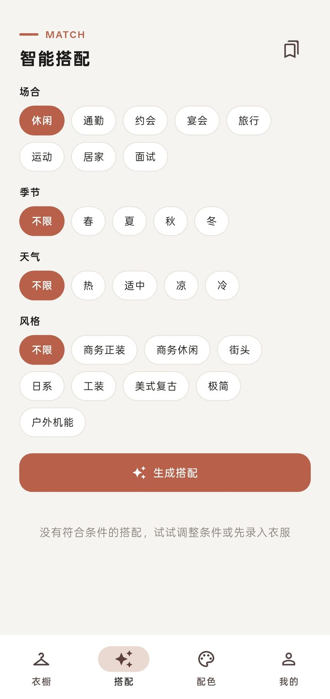
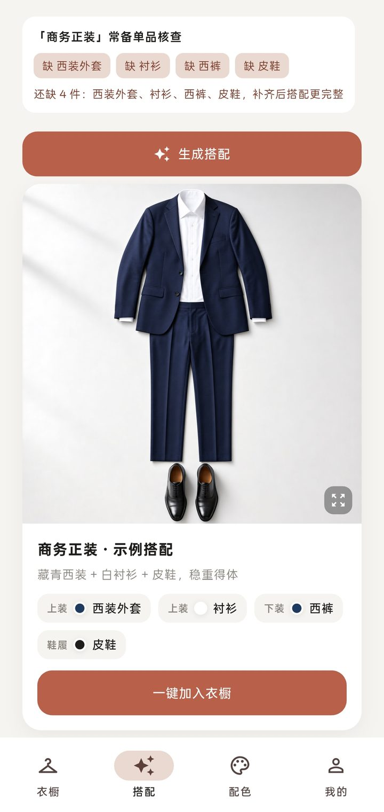
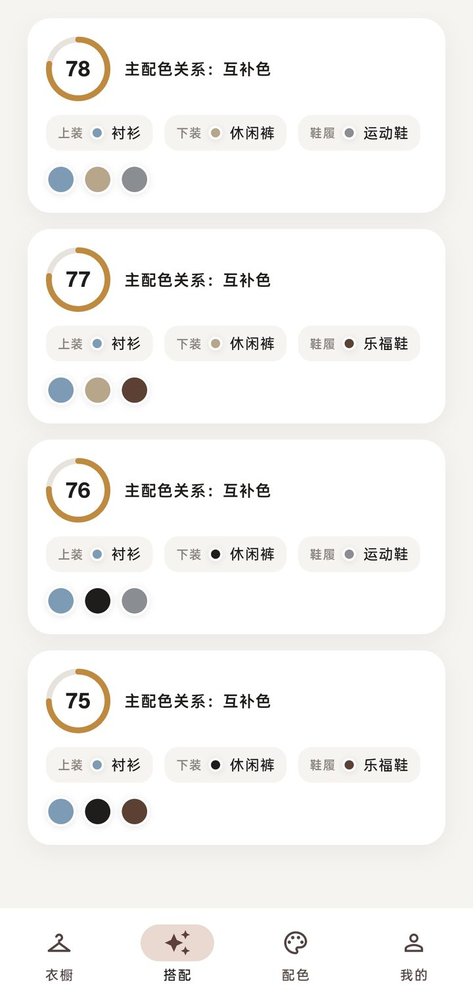
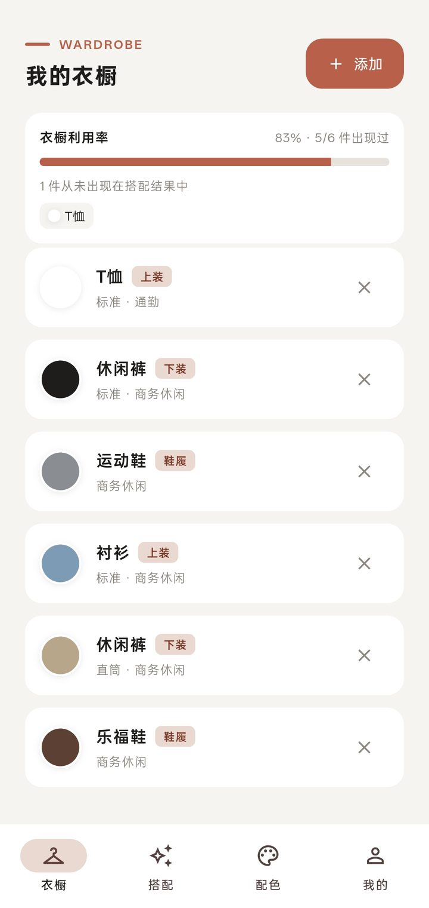
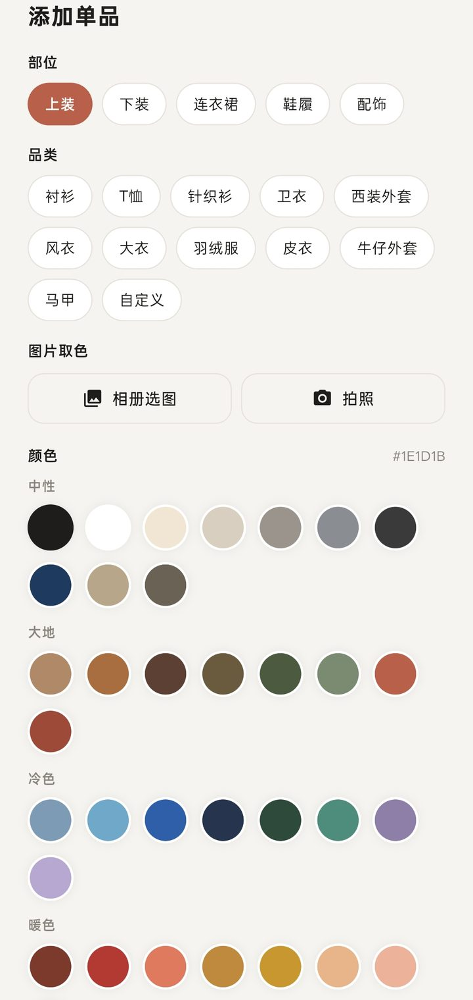
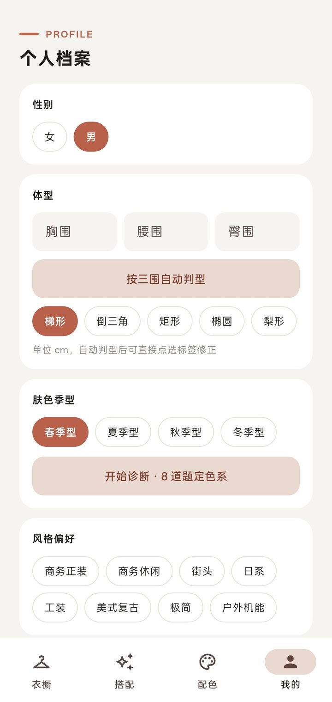
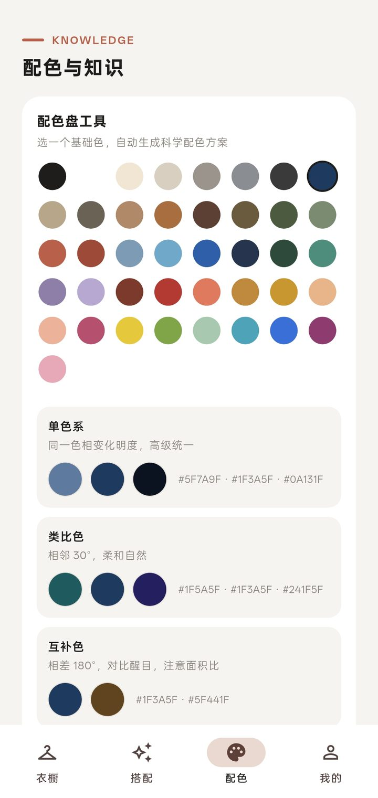

# 爱搭衣 (Ai Da Yi)

一个纯本地的智能穿搭搭配 Android App：以「穿搭知识库 + 色彩算法 + 体型/肤色规则」为内核（**无 AI 模型、无网络、无账号**），从你的衣橱生成可解释的搭配方案与配色说明。

## 功能特性

- **衣橱管理**：拍照/相册取色自动提取主色（可手动修正）、按部位联动的录入表单、品类树选择
- **智能搭配**：硬约束过滤（性别/季节/天气温度/场合/禁忌）+ 六项加权评分（色彩和谐度含肤色季型适配、风格一致性、体型适配、正式度、露肤度、用户偏好）
- **色彩算法**：HSV + 色相环角度差配色公式（单色系/类比/互补/分裂互补/三角色），输出配色原理说明；配色盘交互工具
- **个性化**：性别 × 体型自动判型（三围推断）、肤色四季型 8 题问卷、禁忌过滤、评分权重滑杆自调
- **风格模板**：18 套分性别示例搭配（AI 服装平铺图），空衣橱也能出搭配，一键入库
- **每日推荐**：基于收藏/打卡历史的近期降权，避免重复推荐
- **记录与统计**：收藏 / OOTD 穿搭打卡、衣橱利用率统计、风格缺口分析
- **知识库热更新**：`kb_override` 覆盖目录 + 内容哈希自动重导（风格/品类/体型规则/模板均为 JSON 驱动）

## 界面预览

| 智能搭配：条件筛选 | 搭配结果：一键入库 |
|:---:|:---:|
|  |  |
| **候选方案：评分与配色关系** | **我的衣橱：利用率统计** |
|  |  |
| **录入单品：拍照取色** | **个人档案：体型与肤色季型** |
|  |  |
| **配色盘工具** | |
|  | |

## 技术栈

Flutter (Android) · SQLite (sqflite) · 纯 Dart 规则引擎 · 无任何网络/ML 依赖

## 环境要求

- Flutter SDK（stable 渠道）与 Android SDK / JDK 17+
- 安装配置参考：https://docs.flutter.dev/get-started/install

## 运行

```bash
git clone <本仓库地址>
cd <仓库目录>
flutter pub get
flutter test        # 运行全部单元测试
flutter run         # 连接设备或启动模拟器运行
```

## 打包

```bash
flutter build apk --release
# 产物：build/app/outputs/flutter-apk/app-release.apk
```

> 签名说明：仓库**不包含**签名文件（见下）。缺少签名配置时自动回退 debug 签名，仍可构建安装。

## 签名文件（不入库）

`android/key.properties` 与 `android/app/upload-keystore.jks` 已被 `.gitignore` 排除。需要正式签名打包时自行创建：

```properties
# android/key.properties
storePassword=******
keyPassword=******
keyAlias=upload
storeFile=upload-keystore.jks
```

并将 keystore 文件放到 `android/app/upload-keystore.jks`。**请务必备份这两个文件**——更换签名将无法覆盖安装升级。

## 知识库热更新

风格 / 品类 / 体型规则 / 搭配模板均为 JSON 驱动（见 `assets/data/`）。把同名 JSON 放入应用文档目录的 `kb_override/` 文件夹（App 内「我的 → 设置 → 知识库热更新」可查看具体路径），重启或点击「重新导入知识库」即生效：

`categories.json` · `styles.json` · `body_types.json` · `style_templates.json`

## License

[MIT](LICENSE)
